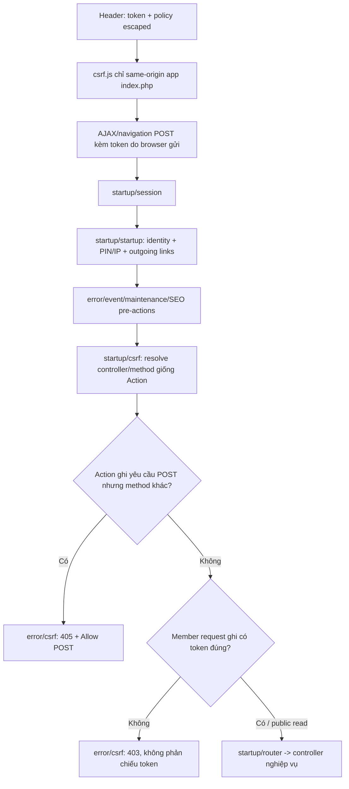

# Hiện hành sau P0-C — kiểm tra CSRF frontend

`startup/startup` chỉ dùng token session cho outbound URL/identity; không ghi đè token trong request. Thêm pre-action `startup/csrf` sau SEO và trước controller. Không đổi schema hoặc model nghiệp vụ.

Policy đặt tại `system/config/application.php`: backend và header dùng chung `csrf_post_routes`/`csrf_navigation_routes`; read-only canonical redirects chỉ áp dụng `csrf_read_routes`. Token vẫn dùng query parameter hiện hữu, là quyết định tương thích chuyển tiếp, không phải token POST/header tách riêng.

[Biên bản P0-C](../improvements/P0-C-frontend-csrf.md) ghi tests, scope và các giới hạn còn lại. Những đoạn mô tả startup tự chèn token trong sơ đồ/báo cáo trước đây là baseline trước sửa.
